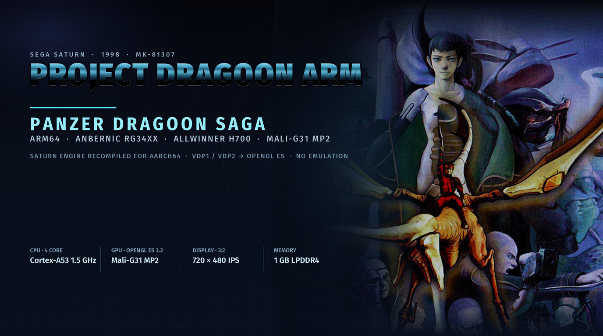

<p align="center">
  
</p>

# ProjectDragoonArm — Panzer Dragoon Saga for the Anbernic RG34XX (ARM64)

A native **AArch64 / OpenGL ES 3.x** port of *Panzer Dragoon Saga* (Sega Saturn,
1998, USA — product MK-81307) for the **Anbernic RG34XX** (Allwinner H700,
Mali-G31 MP2, 720×480 3:2) and compatible PortMaster handhelds.

The port runs the reverse-engineered engine, not an emulator: the game's own
tasks, scripts, field/battle logic and Saturn hardware behaviour are recompiled
for ARM64, with Saturn VDP1/VDP2 presentation translated to OpenGL ES and the
user's own disc supplying the data.

> **Bring your own disc.** No Sega-derived bytes are in this repository. You
> supply your own legally dumped *Panzer Dragoon Saga (USA)* disc set.
> *Panzer Dragoon Saga*, *Sega Saturn* and *Azel* are trademarks of their
> respective owners; this project is independent.

---

## Where the code comes from (read this first)

Three upstream projects matter, and they are **not** interchangeable:

- **[blythos/atolm](https://github.com/blythos/atolm)** — a *verified
  byte-matching decompilation* of the SH-2 binaries. Its stated scope is
  explicit: it is C source, splitter configs and sha256 manifests that
  reproduce the original bytes; it is **not** a playable reimplementation and
  contains no game logic beyond the handful of matched functions (122 of
  253,650 bytes in `1ST_READ.PRG` at last check). It cannot boot a game.
- **[yaz0r/Azel](https://github.com/yaz0r/Azel)** (MIT) — the actual
  reverse-engineered engine: ~160k lines of C++ implementing the game's task
  graph, VDP1/VDP2 state, SCSP audio, scripts and transitions, playable from
  the opening through the Arachnoth battle upstream. **This is the source this
  port builds from**, because it is the only one that runs.
- **[noradninja/Lagi](https://github.com/noradninja/Lagi)** — a PlayStation
  Vita host for Azel, which is the existing proof that Azel's logic can be
  driven by a non-desktop, non-bgfx ARM platform layer.

`atolm` is used here for what it actually provides: **disc identity**. Its
published sha256 manifests gate `tools/extract_disc.py`, so a bad dump is
rejected before it can boot to a black screen.

## Architecture

```text
  [PortMaster package — no disc data, no ROM-derived code]
    Panzer Dragoon Saga.sh          launcher (governors, logging, controllers)
    panzerdragoon/
      panzerdragoon.aarch64         ARM64 engine + GLES renderer + menu
      data/disc1..4/                YOUR extracted disc payload (tools/extract_disc.py)
      port.json / gameinfo.xml      EmulationStation metadata
              │
              ▼
  Azel engine (unmodified upstream sources)
    game tasks · scripts · VDP1/VDP2 register model · SCSP · Cinepak movies
              │  bgfx API calls
              ▼
  platform/arm64/bgfx/              GLES 3.0 implementation of the bgfx subset
              │                     the engine uses (textures, views, state,
              │                     embedded-shader compilation, composite)
              ▼
  libSDL3 (bundled) ──► libmali EGL/GLES 3 ──► Mali-G31 MP2, 720×480
```

Why a bgfx-compatible layer instead of editing the engine: the engine calls
~50 bgfx entry points across 5,000 lines of presentation code. Implementing
that subset over GLES 3.0 keeps every Azel source file pristine, so upstream
fixes stay mergeable, and it drops Vulkan, bgfx's own build and its shader
compiler from the handheld entirely.

**GLES 3.x, not 2.0.** The engine's VDP2 layer shaders are integer-texture
based (`usampler2D` + `texelFetch`, `R32U` plane descriptors). That is GLES 3.0
territory; Mali-G31 MP2 supports GLES 3.2, so this is a supported path — but it
is a real requirement, not a preference. See `docs/PORTING-NOTES.md`.

## Status

**It runs.** Verified on x86_64 with a real GLES 3.2 context: the port boots the
game, presents the SEGA logo and the *AZEL* title card, holds 30.3 FPS, and the
in-game menu opens over the running game. The ARM64 build produces a 4.5 MB
binary needing `libGLESv2.so.2`, `libc`, `libm`, `libpthread` and `libdl` from
the firmware, plus a `libSDL3.so.0` that the package carries itself, with a
maximum symbol version of `GLIBC_2.27`.

| Verified | Evidence |
|---|---|
| Disc pipeline | 1,695 files / 534 MiB from the supplied `.7z` in 7.7 s, 14/14 PRGs matching atolm's sha256 manifest |
| Engine builds for AArch64 | all translation units, `zig c++ -target aarch64-linux-gnu.2.28 -mcpu=cortex_a53` |
| Rendering | `SEGA ENTERPRISES, LTD.` then `AZEL` title card, captured from the GL back buffer |
| Frame rate | 30.3 FPS in the menu overlay (engine paces to the Saturn's 30 Hz) |
| In-game menu | opens over gameplay; display mode, master volume, controls, about, exit |
| ARM64 package | `dist/PanzerDragoonArm-PortMaster-aarch64.zip`, 1.9 MB |
| Self-check | `shim_smoketest` renders 76,800/76,800 pixels through the GLES layer |

**SDL3 is not a firmware library on the H700.** Knulli/Batocera ship SDL2 — with
a home-grown "Mali EGL" fbdev video driver — and no `libSDL3`, `libdrm` or
`libgbm`. The package therefore bundles an SDL3 built for AArch64/glibc 2.28
(`tools/build-sdl3-arm64.sh`: video `dummy`/`offscreen`, audio ALSA loaded
dynamically, joystick evdev) and the port takes its GLES context straight from
libmali's EGL over `/dev/fb0`, installing its own buffer swap. See
`platform/arm64/renderer_gles.cpp`.

**It runs on the handheld.** On 2026-11-23 the port booted on an RG34XX
(Knulli "scarab 2026/05/11"): GLES `3.2 v1.r20p0-01rel0` on Mali-G31, the SEGA
logo and the opening scene captured directly from `/dev/fb0`.

The three things that had to be measured rather than assumed, all of them on
the device:

- **EGL configs here have `surface_type == 0`.** Passing `EGL_SURFACE_TYPE`
  makes `eglChooseConfig` fail with `EGL_BAD_ATTRIBUTE`; ask only for a
  renderable type and depth, then create the window surface with a `NULL`
  native handle.
- **`eglSwapBuffers` lies on this libmali.** It returns `EGL_TRUE` and nothing
  ever reaches the panel. The port publishes by reading the frame back and
  writing it to the off-screen `/dev/fb0` page, then flipping.
- **The engine needs an SDL window even when it renders elsewhere.**
  `renderer.cpp` reads `SDL_GetWindowSize()`, so with no window the resolution
  stays 0 and the composite draws nothing. SDL3's hint is `SDL_VIDEO_DRIVER`
  (SDL2's `SDL_VIDEODRIVER` is ignored); the `offscreen` driver provides the
  window object without GL, which is all that is needed.

- **The codec boots with the speaker muted.** `SPK Switch` is off on this
  firmware while the DAC mixers are on, so a perfectly good audio stream is
  inaudible. The launcher turns it on for the session and restores the original
  value on exit.

Still unmeasured: frame rate on the H700, disc swap, and physical controller
input — see [docs/STATUS.md](docs/STATUS.md).

[docs/STATUS.md](docs/STATUS.md) keeps the full ledger, including what is known
to be incomplete *in the engine itself* (upstream Azel is playable through the
Arachnoth battle; later material is unfinished upstream).

## What it took: four real bugs

Porting this was not a build-flag exercise. The four defects below each made the
game silently render nothing or crash, and all four were found here:

1. **Integer textures cannot be filtered.** The VDP2 layer shaders sample
   `usampler2D` textures (`R8U`, `R32U`). Requesting `LINEAR` filtering on them
   makes the texture incomplete in GLES, so every `texelFetch` returned zero and
   every layer rendered black — with no GL error. The backend now forces
   `NEAREST` for integer formats.
2. **Task work areas were never zeroed.** `createSubTask` uses `new T`, which for
   these aggregates does not run the zeroing `operator new` on the base class.
   `s_videoDecoderNotifyWorkArea::m0_textSpriteTask` started as garbage and the
   first `killTask()` on it segfaulted. All 11 call sites now use `new T()`.
3. **VDP2 VRAM was addressed with a 2 MB mask** over a 512 KB array, so a
   subtitle line that overran its window wrote glyph tiles ~1.4 MB past the
   buffer and corrupted the task heap. The mask is now `0x7FFFF`.
4. **The embedded shader table was stale**, leaving the ESSL/GLSL entries
   commented out, so no shader could be found for a GL backend at all.

Details and the exact patches are in [patches/README.md](patches/README.md) and
[docs/PORTING-NOTES.md](docs/PORTING-NOTES.md).

## Development builds

```bash
cmake -S . -B build-host -G Ninja -DCMAKE_BUILD_TYPE=Release
ninja -C build-host panzerdragoon shim_smoketest

# run against extracted disc data
cd engine-data/disc1 && ../../build-host/panzerdragoon

# prove the GLES layer rasterises (no engine, no disc)
./build-host/shim_smoketest
```

Useful environment switches, all off by default:
`PDS_TRACE_GL`, `PDS_TRACE_TEX`, `PDS_PROBE_VRAM`, `PDS_DUMP_FRAME=<n>`,
`PDS_DUMP_VRAM=<dir>`, `PD_FORCE_SOLID`, `PD_MENU_OPEN`, `PD_FPS_OVERLAY`.

## Quick start

```bash
# 1. Extract your disc into the port's data directory (verifies Disc 1 by sha256)
python3 tools/extract_disc.py --7z "Panzer Dragoon Saga (USA) (Disc 1).7z" \
                              --out portmaster/panzerdragoon/data/disc1

# 2. Cross-compile the ARM64 port and assemble the PortMaster zip
tools/build-arm64.sh

# 3. Copy dist/PanzerDragoonArm-PortMaster-aarch64.zip to the handheld and
#    unzip into ports/
```

## Controls (RG34XX)

| Action | Button |
|---|---|
| Move / menu navigation | D-Pad |
| Confirm / interact | A (South) |
| Cancel / back | B (East) |
| Gun / laser (context) | C (North) / X (West) |
| Dragon / menu shortcuts | Y (West) |
| Rotate camera | L1 / R1 |
| In-game menu | Menu (or Start+Select) |
| Fast-forward (held) | R2 |

Mappings live in `platform/arm64/controls.c` and are rebindable from the
in-game menu.

## Licence and artwork

Port code: MIT. Upstream Azel: MIT (`engine/UPSTREAM-LICENSE-Azel-MIT.txt`).
atolm manifests: MIT.

The README banner is generated by `tools/make_banner.py` from
`assets/source/ref-01.jpg`, the Panzer Dragoon Saga promotional illustration
(Sega). It appears only to identify the game this port runs, is not covered by
this repository's licence, and is regenerated — not hand-edited — so its
provenance stays visible. See `assets/README.md`.

The discs, and everything derived from them, remain the property of their
rights holders; they never enter this repository.
